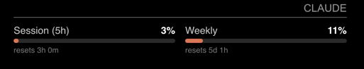

# MMM-ClaudeUsage

A [MagicMirror²](https://magicmirror.builders/) module that shows your Claude Pro/Max plan limits: the 5-hour session window, the weekly window, and per-model
weekly windows (Opus/Sonnet) when the API returns them. Each one gets a progress bar and a reset countdown.



> **Unofficial.** This is a community project, not affiliated with or endorsed by Anthropic. It reads an undocumented endpoint that can change or disappear
> without notice.

## How it works

It polls the same endpoint Claude Code's `/usage` command uses:

```
GET https://api.anthropic.com/api/oauth/usage
Authorization: Bearer <claude.ai OAuth access token>
anthropic-beta: oauth-2025-04-20
```

Response shape: `{ five_hour: {utilization, resets_at}, seven_day: {...}, seven_day_opus: {...}, extra_usage: {...} }`. Enterprise seats return no window data.

Only the MagicMirror server process (`node_helper`) talks to the API, and it runs a single poller shared by every connected browser. Page loads, reloads and
server restarts never trigger extra calls: the last result and any rate-limit backoff are saved to `.usage-state.json`.

## Install

Requires Node 18+ (for built-in `fetch`). There are no runtime dependencies, so no `npm install` is needed.

```bash
cd ~/MagicMirror/modules
git clone https://github.com/ericjohncarlson/MMM-ClaudeUsage.git
```

To update later: `cd ~/MagicMirror/modules/MMM-ClaudeUsage && git pull`.

## Credentials

The module needs a claude.ai OAuth refresh token. Browser clients (e.g. a Pi running Chrome in kiosk mode) need nothing.

### 1. Get a refresh token

Give the mirror its own login so it doesn't fight your workstation over token rotation. Both options below create a fresh, throwaway Claude Code session and
print its refresh token. Inside Claude Code, run `/login`, finish the browser sign-in, then `/exit`.

**With Docker (works anywhere, including macOS):**

```bash
docker run --rm -it node:22 bash -c '
  npm i -g @anthropic-ai/claude-code >/dev/null &&
  claude &&
  echo && jq -r .claudeAiOauth.refreshToken ~/.claude/.credentials.json 2>/dev/null ||
  node -e "console.log(require(\"/root/.claude/.credentials.json\").claudeAiOauth.refreshToken)"'
```

**On a Linux box that already has Claude Code and `jq`:**

```bash
D=$(mktemp -d)
CLAUDE_CONFIG_DIR=$D claude
jq -r .claudeAiOauth.refreshToken "$D/.credentials.json"
rm -rf "$D"
```

(The second option doesn't work on macOS: Claude Code stores credentials in the Keychain there, not in a file.)

### 2. Put it in `.env`

Create `modules/MMM-ClaudeUsage/.env` (see [`.env.example`](.env.example)):

```
CLAUDE_REFRESH_TOKEN=sk-ant-ort01-...
```

That's it. Refresh tokens are single-use: on every refresh the module writes the new one **back into `.env`** (other lines and comments are preserved) and keeps
the current access token in `.token-cache.json`. You can replace the module folder or delete the cache freely, as long as you keep the current `.env`.

Keep `.env` private (`chmod 600 .env`); the module tightens it and `.token-cache.json` to `600` whenever it writes them. Never commit either file.

Don't restore an older `.env` from a backup. Its token is already spent and you'll see `HTTP 400 — refresh token already used`.

### Docker / environment variables

The same variables can come from the container environment instead (`env_file:` in compose); process env wins over the file. In that case the module can't
rewrite your env, so the rotated token lives only in `.token-cache.json`. Keep that file on a persistent volume.

| Var                       | Required | Notes                                                                        |
| ------------------------- | -------- | ---------------------------------------------------------------------------- |
| `CLAUDE_REFRESH_TOKEN`    | yes\*    | Long-lived; the module mints access tokens from it                           |
| `CLAUDE_ACCESS_TOKEN`     | no       | Seeds the first access token. \*On its own it works until it expires (hours) |
| `CLAUDE_TOKEN_EXPIRES_AT` | no       | ms epoch for the seeded access token                                         |

### Alternatives

- **Claude Code runs on the same host/container:** leave `.env` absent. The module reads `~/.claude/.credentials.json` on each poll (Claude Code keeps it
  fresh). It won't refresh that borrowed token unless you set `allowRefresh: true`.
- **`token:` in config:** a raw access token. For testing only: it expires within hours, and MagicMirror sends module config to every browser, so anyone who can
  load the mirror page can read it.

## Config

```js
{
  module: "MMM-ClaudeUsage",
  position: "top_right",
  config: {
    updateInterval: 5 * 60 * 1000, // don't go lower; the endpoint 429s
    hideZero: true,
    warnAt: 70,
    critAt: 90
  }
}
```

| Option            | Default                                                            | Notes                                                                                                |
| ----------------- | ------------------------------------------------------------------ | ---------------------------------------------------------------------------------------------------- |
| `title`           | `"Claude"`                                                         | Rendered as the standard MagicMirror header. MagicMirror's own `header:` option takes precedence     |
| `columns`         | `2`                                                                | Windows per row; `1` gives a vertical stack                                                          |
| `width`           | `null`                                                             | CSS width such as `"260px"`; `null` fits the region                                                  |
| `windows`         | `["five_hour", "seven_day", "seven_day_opus", "seven_day_sonnet"]` | Which rows to show, in order. Keys the API doesn't return are skipped                                |
| `labels`          | see below                                                          | Row labels, keyed by window                                                                          |
| `hideZero`        | `false`                                                            | Hide per-model rows sitting at 0% (`five_hour` and `seven_day` always show)                          |
| `warnAt`          | `70`                                                               | Percent at which the bar turns yellow                                                                |
| `critAt`          | `90`                                                               | Percent at which the bar turns red                                                                   |
| `showExtraUsage`  | `true`                                                             | Show extra-usage spend when it's enabled on the account                                              |
| `staleAfter`      | `20 * 60 * 1000`                                                   | Flag data older than this (ms)                                                                       |
| `updateInterval`  | `5 * 60 * 1000`                                                    | Poll interval (ms), minimum 5 min. 429s back off exponentially up to 1 hour, honouring `Retry-After` |
| `credentialsFile` | `"~/.claude/.credentials.json"`                                    | Claude Code's credential file, used only when there's no `.env` token                                |
| `token`           | `null`                                                             | Raw access token; overrides everything else                                                          |
| `allowRefresh`    | `false`                                                            | Also refresh tokens borrowed from `credentialsFile` (`.env` tokens always refresh)                   |

Default labels:

| Key                    | Label       |
| ---------------------- | ----------- |
| `five_hour`            | `5-hour`    |
| `seven_day`            | `Weekly`    |
| `seven_day_opus`       | `Opus wk`   |
| `seven_day_sonnet`     | `Sonnet wk` |
| `seven_day_oauth_apps` | `Apps wk`   |
| `seven_day_cowork`     | `Cowork wk` |

The last two aren't in the default `windows` list; add them there if your account returns them.

## Troubleshooting

| Message                                                                  | Cause / fix                                                                                                   |
| ------------------------------------------------------------------------ | ------------------------------------------------------------------------------------------------------------- |
| `Token refresh failed: HTTP 400 — refresh token already used or revoked` | The token in `.env` was spent elsewhere (old backup, shared with another machine, logged out). Mint a new one |
| `Rate limited — retry in …`                                              | The endpoint returned 429. The module backs off on its own; don't lower `updateInterval`                      |
| `No token: add CLAUDE_REFRESH_TOKEN to …`                                | No `.env`, no env vars, and no Claude Code credentials file found                                             |
| `OAuth token expired — update .env …`                                    | A borrowed `credentialsFile` token expired and `allowRefresh` is off                                          |
| Rows never appear                                                        | Enterprise seats return no window data                                                                        |

Errors are also logged to the MagicMirror server console with a `[MMM-ClaudeUsage]` prefix.

## Quick check from the shell

```bash
TOKEN=$(jq -r .claudeAiOauth.accessToken ~/.claude/.credentials.json)
curl -s https://api.anthropic.com/api/oauth/usage \
  -H "Authorization: Bearer $TOKEN" -H "anthropic-beta: oauth-2025-04-20" | jq
```

## API-key (Console) usage instead?

The documented Admin API (`/v1/organizations/usage_report/messages`, `/v1/organizations/cost_report`) covers pay-per-token API orgs, needs an `sk-ant-admin…`
key, and reports tokens and cost, not plan limits. This module doesn't use it.

## Development

```bash
npm install
npm run format        # prettier --write
npm run format:check  # what CI runs
```

## License

[MIT](LICENSE)
